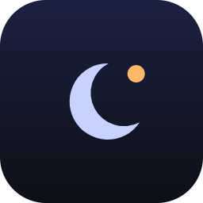
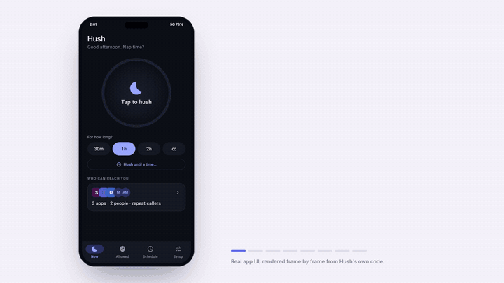
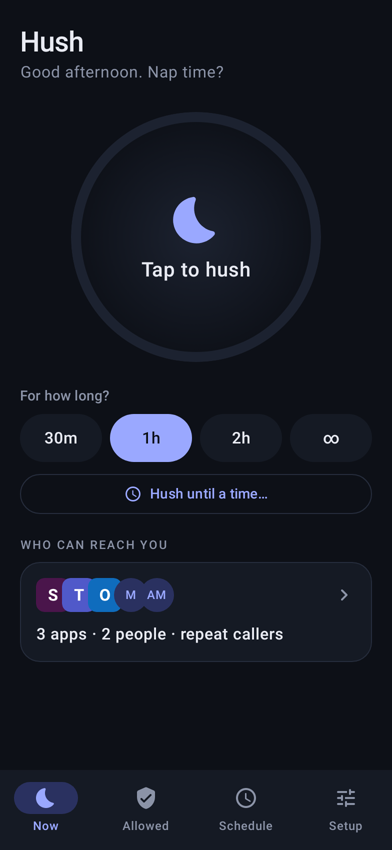
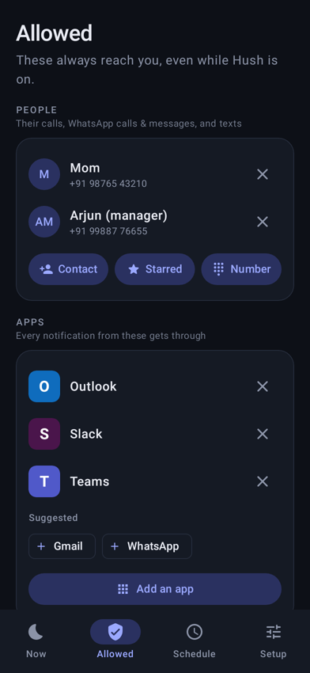
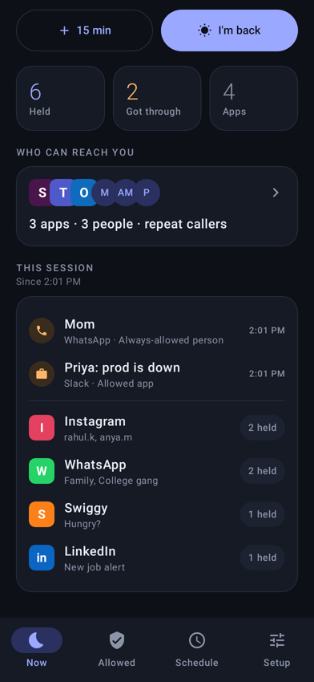
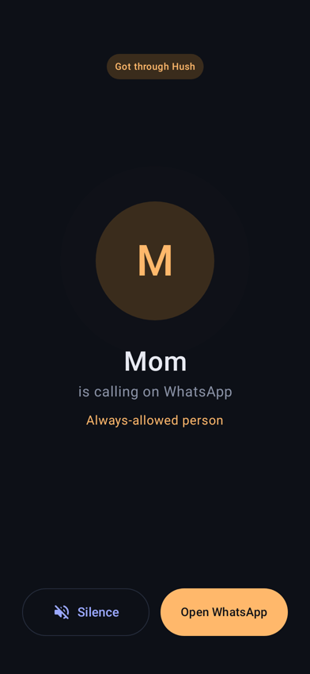

<div align="center">



# Hush

**Do Not Disturb that lets the right people through.**

Silence everything. Except your people, your work apps, and anyone calling twice.

[Download the APK](https://github.com/himanshuSri24/hush/releases/latest) · Android 10+ · Free & open source · No internet permission



</div>

---

## Why

Android's Do Not Disturb has a "starred contacts" exception. It failed me: a starred contact called
several times and not one of those calls came through. It also doesn't cover WhatsApp calls
or messages at all, which is how most people actually reach you.

Hush doesn't depend on that exception.

## How it works

1. **You tap Hush.** The phone switches to Do Not Disturb, *alarms only*. Nothing makes a sound, and
   your nap alarm still rings.
2. **Hush watches every notification and call.** It needs notification access and phone access for this.
3. **When something should get through, Hush rings for it on the alarm channel.** Do Not Disturb always
   lets that channel through. Calls ring until answered and light up the screen. Messages chime once.
4. **Everything else waits silently** in your notification shade. When you're back, Hush shows a
   summary of what it held.

### What gets through

| | |
|---|---|
| **Your people** | Calls, SMS, WhatsApp / WhatsApp Business calls and messages, Telegram, Signal. Matched by name or number (`+91 98765 43210` = `098765 43210`; `Mom ❤️ (3 messages)` = `Mom`). |
| **Your work apps** | Slack, Teams and Outlook by default. Add any app. |
| **Repeat callers** | Anyone who calls twice within 15 minutes (5, 10 or 30 if you prefer), on the phone or WhatsApp. |
| **Group chats** | Off by default. Turn it on to ring when one of your people posts in a group. |

### Ways to turn it on

The big button (30 min, 1 h, 2 h, until you turn it off, or until a time), a Quick Settings tile, or a
schedule such as *weekdays 1:30–2:15 PM* or *every night*.

## Screens

<p align="center">




</p>

<sub>Real app UI, rendered from the app's own code (see <a href="#how-the-demo-is-made">how the demo is made</a>).</sub>

## Install

1. Download `Hush-1.0.apk` from [Releases](https://github.com/himanshuSri24/hush/releases/latest) and install it.
2. Open Hush. The **Setup** tab lists each permission with a one-tap **Allow**:
   notification access, Do Not Disturb access, phone, contacts, notifications, full-screen alerts, and battery.
3. Add your people on the **Allowed** tab (pick a contact, import your starred contacts, or type a number).
4. Use **Try it** on the Setup tab to hear exactly what a breakthrough sounds like.

## Privacy

Hush has **no internet permission**. Your contacts, numbers and notification contents never leave the phone.
Everything is stored in the app's private storage.

## Build

```bash
./gradlew testDebugUnitTest      # rule-engine tests
./gradlew assembleRelease        # needs your own signing.properties, else debug-signed
```

Requires JDK 17 and the Android SDK (compileSdk 36).

### End-to-end test on a phone

```bash
./gradlew assembleDebug && bash scripts/device-test.sh
```

This installs the debug build (`com.devwithcoffee.hush.debug`, which installs next to the real app) and grants
its permissions over adb. It then turns Hush on and posts real notifications. It checks three things: Do Not
Disturb switches to alarms-only, your people and allowed apps get through while strangers are held, and the
summary appears. It also saves screenshots of every screen.

### How the demo is made

`DemoRecording` (a Robolectric test) launches the real `MainActivity` on the JVM and taps through it,
capturing a frame every 33 ms of virtual time. `marketing/demo/demo.html` frames those images in a phone with
captions, and `marketing/launch-film/` is the code-rendered launch film. During the recording, the
notifications are injected into the app's store rather than sent by real apps.

```bash
./gradlew testDebugUnitTest -PhushDemo=1 --tests "*DemoRecording*"
```

## Code map

| File | What |
|---|---|
| `core/Rules.kt` | Decision engine: hold vs. through, name/number matching, repeat callers |
| `core/Schedules.kt` | Recurring windows, including overnight ones |
| `engine/HushListener.kt` | Notification listener + phone-state receiver |
| `engine/Hush.kt` | Start / stop / extend, Do Not Disturb filter, alarms, reconcile on boot |
| `engine/Alerter.kt` | Rings and vibrates on the alarm stream, full-screen call alert |
| `ui/` | Compose screens: Now, Allowed, Schedule, Setup, full-screen alert |

## Limits

- Some phones (Xiaomi, Oppo, Vivo, and some Samsung models) kill background apps aggressively. Allow
  "Never put Hush to sleep" in Setup.
- Hush matches WhatsApp senders by the name shown in the notification. Save your people in your contacts
  under the same name.
- Android 15's "Modes" show Hush's Do Not Disturb as a mode owned by Hush. That is expected.

## License

[MIT](LICENSE)
